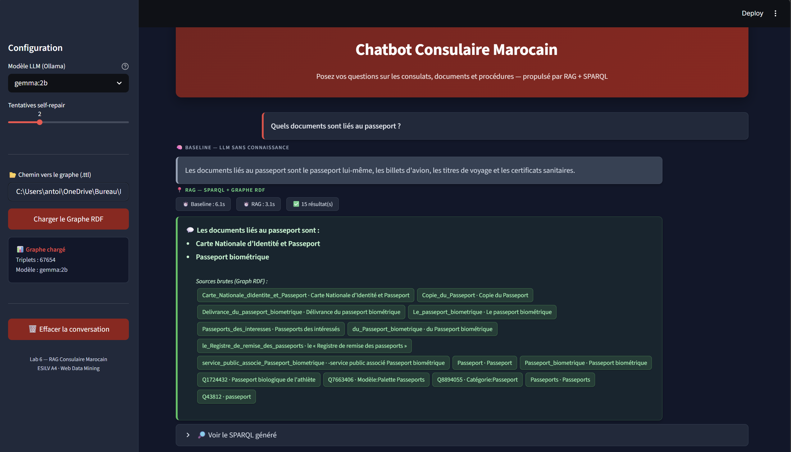

# Moroccan Consular Knowledge Graph & RAG Assistant

**Web Data Mining · Knowledge Graphs · RDF/SPARQL · Entity Linking · Knowledge Graph Embeddings · Local LLMs**

An academic team project exploring the extraction and organization of public information about Moroccan consular administration into a queryable knowledge graph, with a **local LLM-powered Streamlit assistant**.



## What it does

The end-to-end system connects multiple approaches:

1. **Web crawling** of public consular pages using Requests/Beautiful Soup and Selenium.
2. **Information extraction** of entities and relationships from French-language pages.
3. **Knowledge graph construction** in RDF/Turtle, ontology modeling and Wikidata alignment.
4. **Graph expansion and reasoning** with SPARQL and rule-based inference.
5. **Knowledge graph embeddings** with TransE and DistMult.
6. **Graph-grounded RAG**: a local LLM generates SPARQL, executes it, and attempts to repair invalid queries; a Streamlit UI compares responses with and without grounding.

```text
Public web pages → Crawling → Entity/Relation Extraction
                                         ↓
                          RDF graph + Ontology + Wikidata
                                         ↓
                          Expansion / Reasoning / KGE
                                         ↓
Question → Local LLM → SPARQL → Graph results → RAG response
                                         ↓
                              Streamlit chatbot
```

## Reported results

The original project's README reports **67,654 expanded-KB triples**, **32,674 entities**, and **232 relations**. The checked-in `src/data2/statistics_report.json` reports **56,938 triples** for its recorded stage, so counts differ by artifact/stage. These figures are from the original team project, not independently reproduced here.

| Knowledge graph embedding | MRR | Hits@1 | Hits@3 | Hits@10 |
|---|---:|---:|---:|---:|
| TransE (full) | 0.164 | 0.039 | 0.230 | 0.387 |
| DistMult (full) | **0.250** | **0.200** | 0.262 | 0.348 |
| TransE (20k sample) | 0.086 | 0.015 | 0.107 | 0.212 |

The table reproduces the rounded values stored in the team's evaluation artifact.

## Quick start — chatbot

Requires **Python 3.10+**, **Ollama**, and a local language model.

```bash
git clone https://github.com/fdlghita/consular_chatbot.git
cd consular_chatbot
python -m venv .venv
# On Windows: .venv\Scripts\activate
# On macOS/Linux: source .venv/bin/activate
pip install -r requirements.txt
ollama pull gemma:2b
streamlit run src/lab6_app.py
```

Run the Ollama service locally if it isn't already running. Open **http://localhost:8501**, load the default `src/data2/expanded_kb.ttl` RDF graph, and ask a question. The app needs sufficient memory to load the graph and local model. For entity extraction experiments, install the French spaCy model: `python -m spacy download fr_core_news_lg`.

## Code map

| Path | Description |
|---|---|
| `src/lab1_part1/` | Static and dynamic crawlers |
| `src/lab1_pipeline_part2.py` | Entity and relation extraction |
| `src/lab4_pipeline.py` | RDF graph, Wikidata alignment and expansion |
| `src/lab5_pipeline.py` | Reasoning and knowledge graph embeddings |
| `src/lab5_part2_fix.py` | KGE utilities |
| `src/lab6_pipeline.py` | NL-to-SPARQL, execution, self-repair and baseline comparison |
| `src/lab6_app.py` | Interactive Streamlit chatbot |
| `src/data2/` | RDF graph and ontology artifacts |
| `src/data5/evaluation_results.json` | Reported embedding evaluation |
| `RAG_README.md` | Detailed RAG explanation |

For a module-by-module walkthrough, see the [original team's README](https://github.com/Antoine-GourdonHuet/web-datamining-Project).

## Scope & limitations

- **Academic prototype**, not an official Moroccan consular service. Verify any requirements, deadlines, or official procedures directly with the relevant authorities.
- The local Ollama model is not bundled, and crawler runs may depend on third-party websites, access policies and environment setup.
- Large training artifacts, Selenium executables, and generated caches are intentionally omitted. This portfolio edition retains representative code, RDF assets, an example interface screenshot, and published evaluation artifacts.
- **No independent end-to-end test** has been performed for this copied edition. Outputs are not guaranteed up to date.

## Team credit and provenance

This project was originally developed collaboratively for **ESILV — Web Data Mining (2025–2026)**. This repository is a **portfolio presentation of the team project**, not a claim that all components were written individually by Ghita Fadili. Specific code ownership is not assigned here without corroboration.

**Original team repository:** https://github.com/Antoine-GourdonHuet/web-datamining-Project

**Original academic use note:** The source repository states this work is for academic use only and does not include an explicit open-source license. Reuse remains subject to the original authors' rights and applicable dataset terms.
